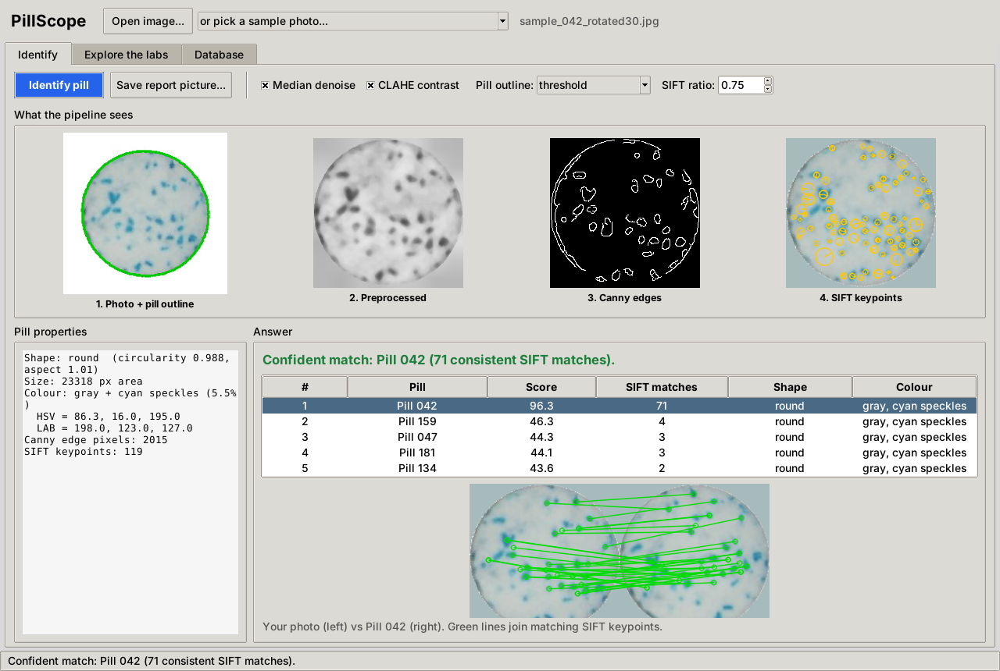
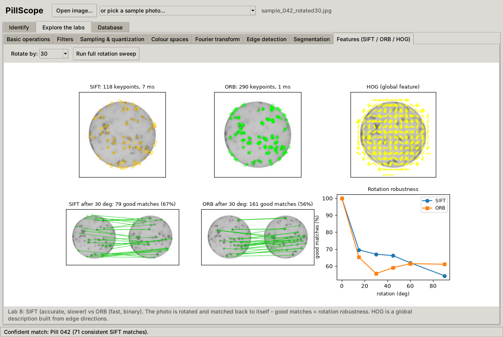

# PillScope

Identify a pill from a photo using classical computer vision (OpenCV, no machine learning).
Load a photo, and the app finds the pill, measures its shape and colour, and looks it up in a database of 251 known pills by matching SIFT keypoints. It also tells you when a pill is probably *not* in the database.



This project combines the eight Computer Vision lab programs (Lab 1 to Lab 8) and the pill-database tool into one application. Each lab is now one stage of the pipeline, and the original lab experiments are still available in the **Explore the labs** tab.

## How it works

```
photo
  |  Lab 7  find the pill: threshold the difference from the background (or grow the background
  |         from the corners), keep the biggest blob
  |  Lab 7  measure the outline: shape name, circularity, aspect ratio
  |  Lab 4  colour signature: base colour (HSV / LAB) + coloured speckles
  |  Lab 1+6  crop, grayscale, median denoise, CLAHE contrast, Canny edges
  |  Lab 4  colour histogram   Lab 5  FFT texture profile   Lab 8  HOG + SIFT keypoints
  v
compare with every pill in the database  ->  rank the best matches  ->  verdict
```

The deciding clue is **SIFT**: keypoints are matched with Lowe's ratio test, then only matches that agree on one rotation + scale + shift (RANSAC) are counted. Right matches have 29+ consistent keypoints, pills that are not in the database have about 3, so the app says
*Confident match* (20+), *Possible match* (10 to 19) or *No reliable match* (under 10).
Colour, FFT texture and HOG are cheaper clues that add to the score and break ties.

| Lab | Original file | Module | Used for |
|---|---|---|---|
| 1 | `lab 1(a).py`, `lab 1(b).py` | `basic_ops.py` | grayscale, geometry, arithmetic (Explore tab) |
| 2 | `Lab2CV.py` | `spatial.py` | convolution vs correlation (Explore tab) |
| 3 | `Lab3CV.py` | `sampling.py` | sampling and quantization (Explore tab) |
| 4 | `Lab4CV.py` | `color.py` | colour signature and histogram (pipeline) |
| 5 | `Lab5CV.py` | `frequency.py` | FFT texture profile (pipeline), ideal filters (Explore) |
| 6 | `Lab6CV.py` | `edges.py` | denoise, CLAHE, Canny (pipeline), Sobel/LoG (Explore) |
| 7 | `Lab7CV.py` | `segmentation.py` | pill outline and shape (pipeline), region growing (Explore) |
| 8 | `Lab8CV.py` | `features.py` | SIFT matching and HOG (pipeline), ORB comparison (Explore) |
| DB | `pillDatabase.py` | `database.py` | CSV database, validation checks, feature cache |

Labs 2 and 3 are not part of the identification itself; they live in the Explore tab.

## Results

Tested on the 251 pills in `data/gallery` (`python scripts/evaluate.py --source <pill_images folder>`):

| Test | Top-1 | Top-5 |
|---|---|---|
| Same photo | 100.0% | 100.0% |
| Rotated 30 / 45 / 180 degrees | 99.6% / 99.2% / 99.6% | 99.6% |
| Shrunk to 70% | 99.6% | 99.6% |
| Gaussian noise | 99.6% | 100.0% |
| Darker | 100.0% | 100.0% |
| **Real photos rotated 30 degrees (227 from the dataset)** | **99.1%** | **100.0%** |

About 0.08 seconds per photo. Of the two misses at 45 degrees, one looks like the same pill stored twice under different numbers (74 matching keypoints), the other is a real miss (it gets flagged as "no reliable match").

**Read this before quoting the numbers.** These tests check whether a pill the database already knows can be recognised again after rotation, shrinking, noise or dimming. They do **not** show that the app can identify pills it has never seen, because the dataset has no imprint, dose or maker information, only photos. Only 75 of the 227 `(N)r30.jpg` photos carry the same number as the original they were made from, so the right answer for that test is found by comparing pixels, not by trusting the file name.

## Quick start

Python 3.9 or newer. Tkinter ships with the Windows installer.

```
pip install -r requirements.txt
python run.py
```

On first start the app computes features for the database (a few seconds). Pick a sample from the drop-down, or use **Open image...**. Samples in `data/samples`:

- `sample_*_rotated30.jpg`: known pills photographed at a different angle
- `sample_100_rotated45_noisy_dark.jpg`: a known pill, rotated, noisy and dim
- `sample_unknown_pill252_not_in_database.jpg`: a pill that was left out of the database on purpose, so the answer should be "no reliable match"

Without a window:

```
python scripts/identify.py data/samples/sample_042_rotated30.jpg --report outputs/report.png
```

Rebuild the database from the dataset folder (the files named `12.jpg` are the originals):

```
python scripts/build_database.py --source "C:/path/to/pill_images"
python scripts/evaluate.py --source "C:/path/to/pill_images"
```

## The app

| Tab | What it does |
|---|---|
| **Identify** | Photo to answer, with every pipeline stage shown, the top 5 matches, and a picture of the matching keypoints. "Save report picture" exports a summary. |
| **Explore the labs** | One panel per lab with sliders: basic operations, filters, sampling, colour spaces, Fourier, edges, segmentation (click to place a seed), SIFT/ORB/HOG. |
| **Database** | Browse, edit and delete pills, add a pill from a photo (shape and colour are measured for you), import a folder, and run the checks from the original `pillDatabase.py` (missing fields, colour that disagrees with the image, duplicate imprints). |



## Project layout

```
run.py                     start the app
pillscope/
  pipeline.py              analyze() and identify(): the whole pipeline
  basic_ops.py spatial.py sampling.py color.py frequency.py edges.py segmentation.py features.py
  database.py              CSV + feature cache
  report.py                one-picture summary
  gui/                     Tkinter app (identify_tab, panels, database_tab, app)
scripts/                   build_database.py, evaluate.py, identify.py
data/                      pill_database.csv, gallery/ (reference photos), samples/
docs/screenshots/
```

## Limits

- Matching works on the speckle pattern, so it suits pills that are visibly different from each other. Pills that differ only by a printed imprint need an imprint reader (OCR), which is not included.
- The pill is expected on a plain, light background with one pill per photo.
- The imprint, dose and maker columns of the database are empty. Fill them in the Database tab.
- Some images in the source dataset are truncated JPEGs. OpenCV prints "Corrupt JPEG data" warnings for them; it is harmless.

## Ideas for next steps

- Add imprint reading (OCR) so pills with the same look can be told apart.
- Detect and split several pills in one photo (connected components + watershed).
- Use a spatial index (for example FLANN) when the database grows past a few thousand pills.
